# Real-Time Multi-Camera Attendance System

Full case study: <a href="https://nahian.ami.bd/">nahian.ami.bd</a>

  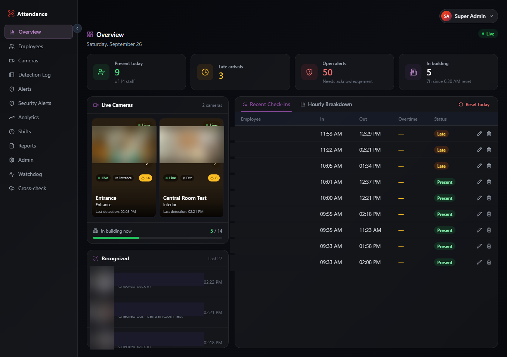

This is an advanced computer vision platform designed for seamless attendance tracking and facility security. By utilizing real-time camera feeds, it provides automated facial recognition, personnel tracking, and instant security alerts without the need for physical badges or biometric scanners.

## System Interface Gallery

### Dashboard & Analytics
<table><tr>
<td valign="top" width="50%">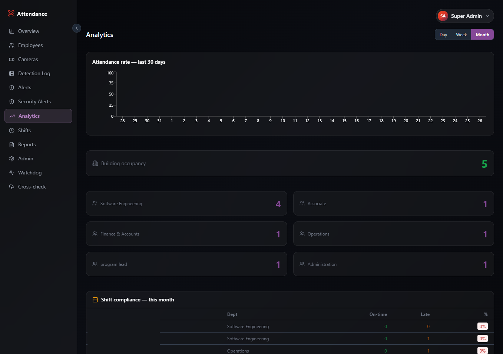</td>
<td valign="top" width="50%">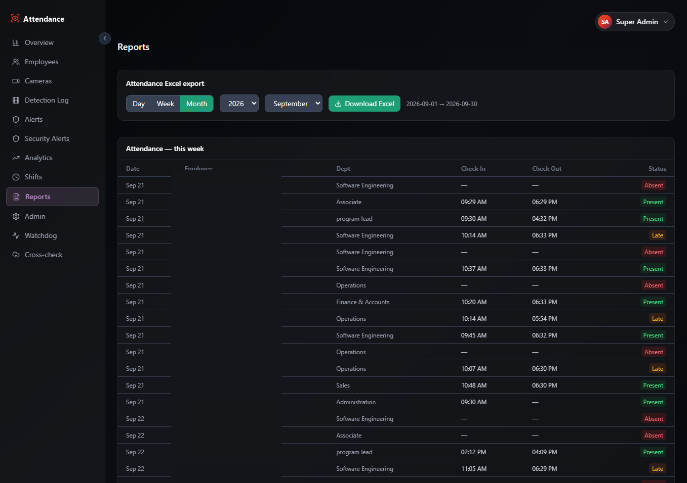</td>
</tr></table>

### Detection & Camera Management

  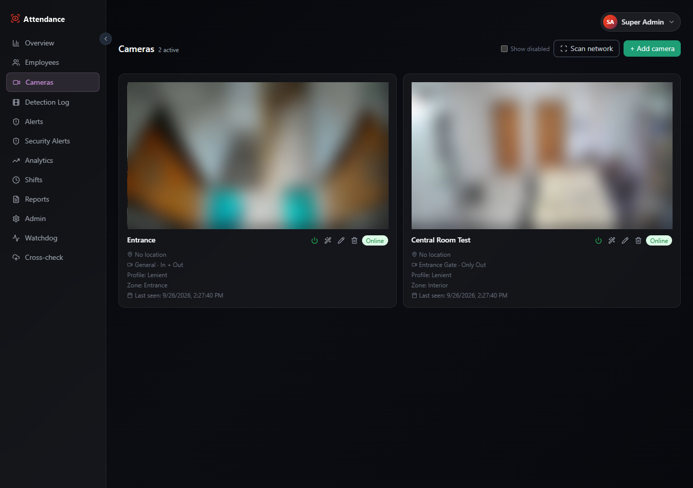

<table><tr>
<td valign="top" width="50%">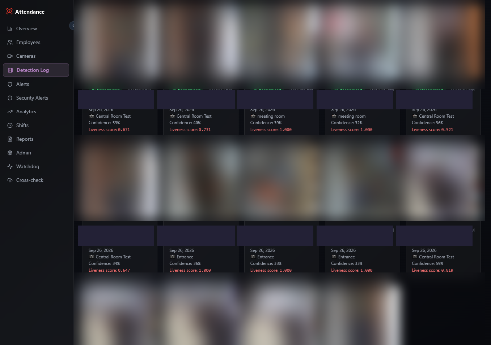</td>
<td valign="top" width="50%">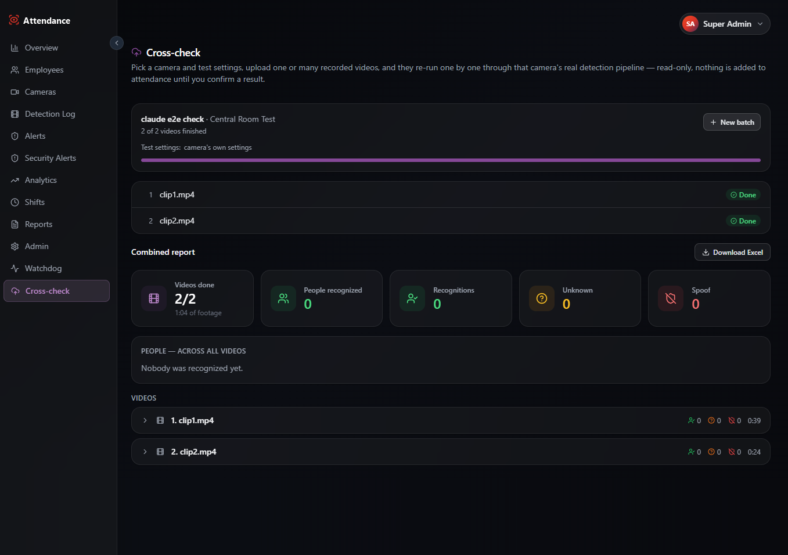</td>
</tr></table>

### Security & Alert Systems
<table><tr>
<td valign="top" width="50%">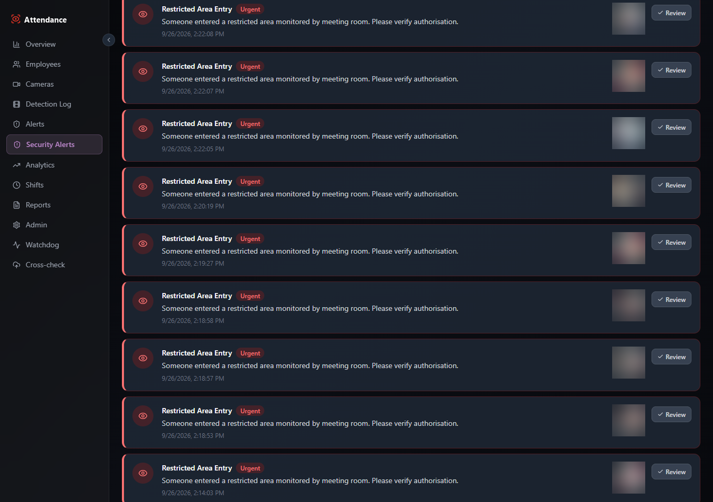</td>
<td valign="top" width="50%">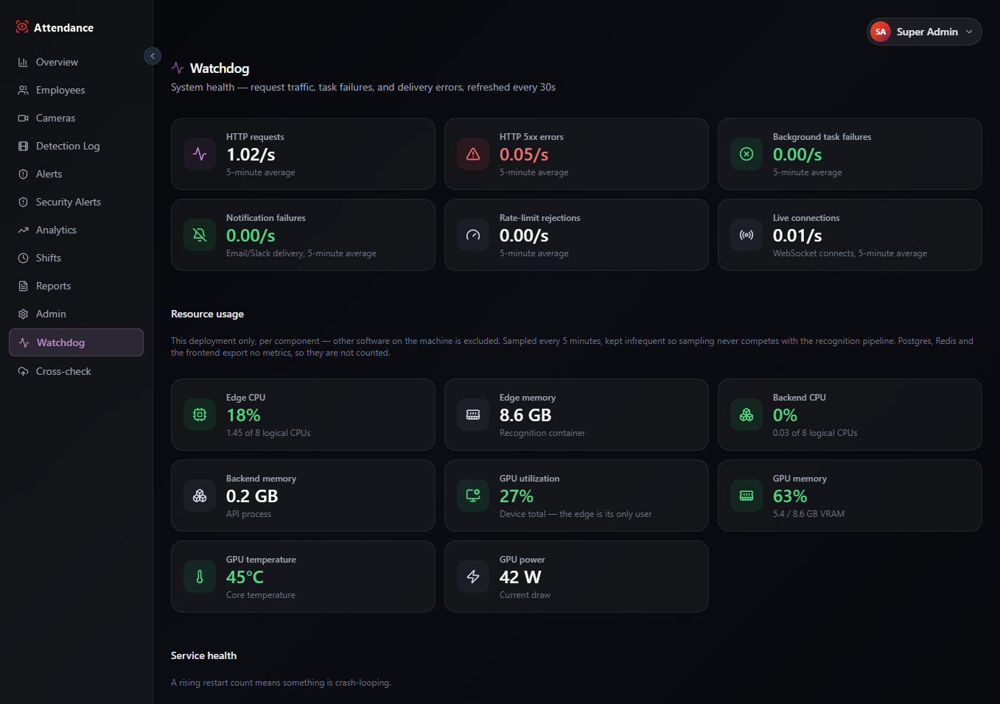</td>
</tr></table>

### Employee Management
<table><tr>
<td valign="top" width="50%">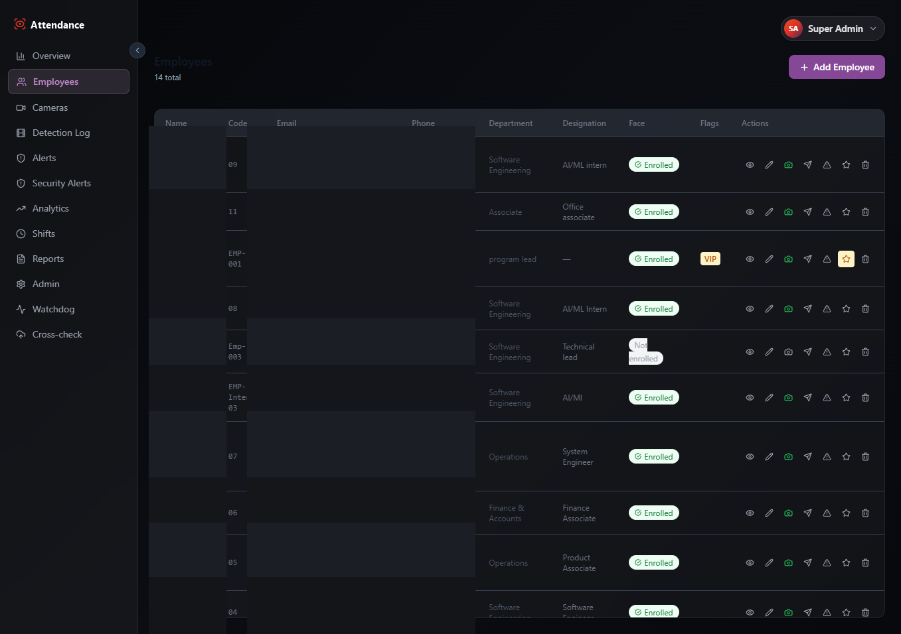</td>
<td valign="top" width="50%">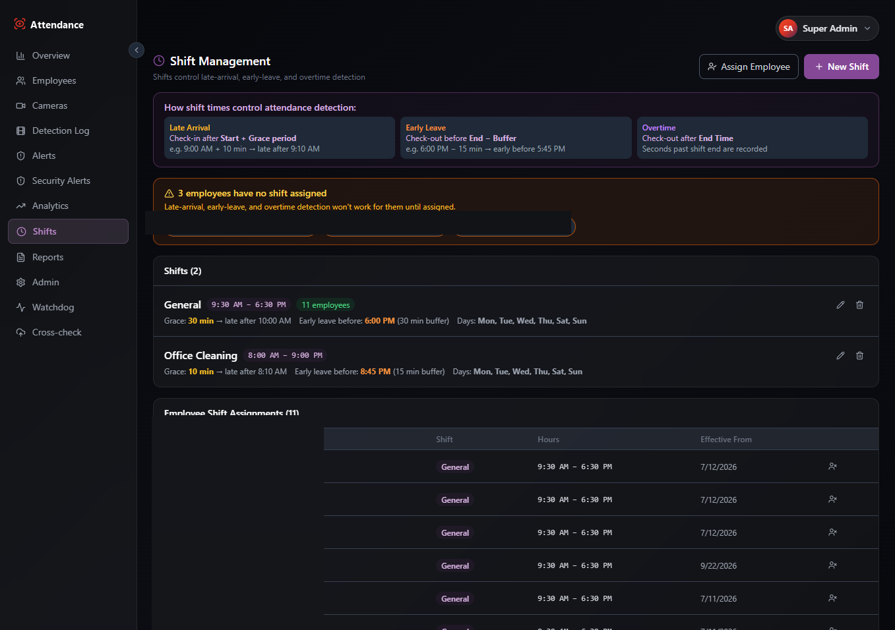</td>
</tr></table>

<b>View Additional Interfaces</b>

 

  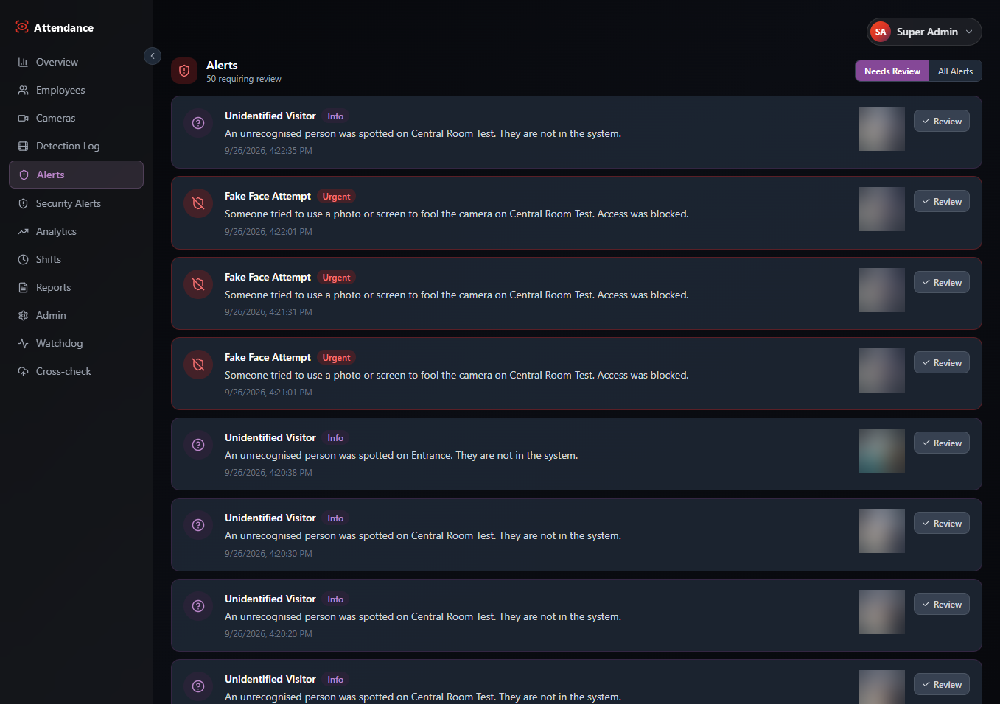

  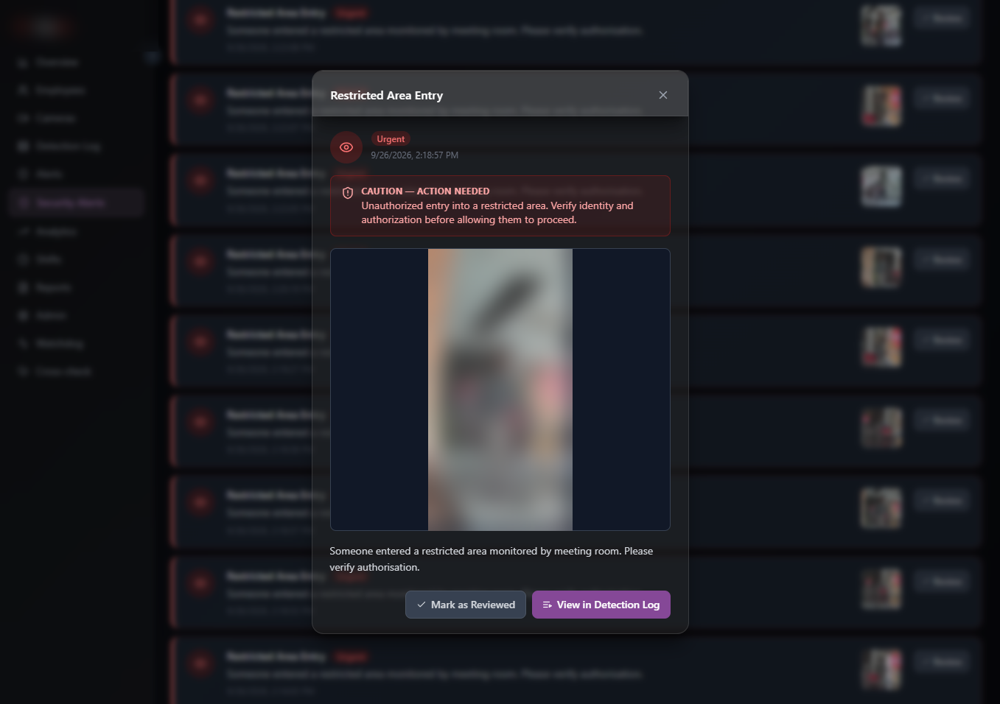

  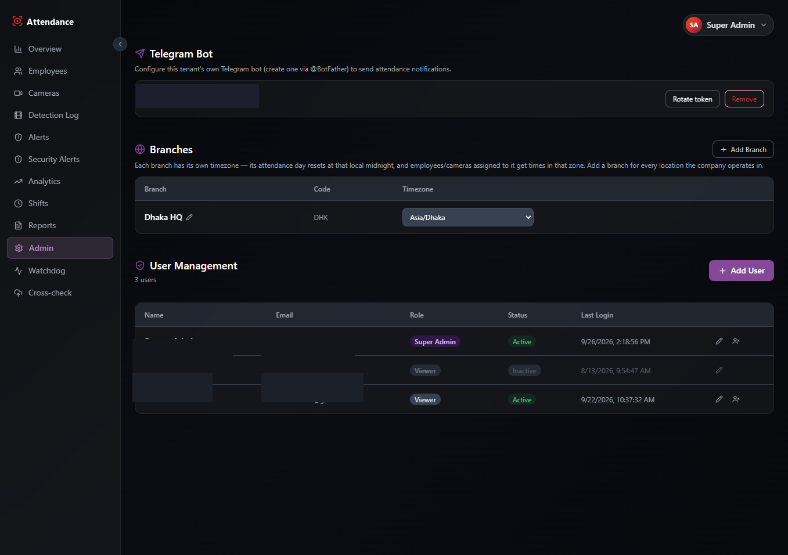

---

## Key Features

- **Real-Time Facial Recognition:** Identifies personnel instantly using optimized YOLOv11 and AdaFace models.
- **Automated Attendance:** Logs entry and exit times with precision, automatically calculating late arrivals, early departures, and overtime.
- **Proactive Security Alerts:** Notifies administrators regarding unauthorized intrusions, blacklisted individuals, masked faces, suspicious baggage, and irregular after-hours activity.
- **Anti-Spoofing Mechanisms:** Detects and blocks fraudulent authentication attempts using photographs or pre-recorded videos.
- **Low-Light Enhancement:** Dynamically adjusts underexposed video frames to ensure reliable detection during nighttime or in poorly lit environments.
- **Automated Camera Calibration:** Simplifies deployment by enabling new cameras to configure themselves based on a single reference frame.
- **Continuous Learning:** The recognition pipeline progressively refines its accuracy based on historical environmental data.
- **Historical Auditing:** Allows administrators to process archived footage through the AI pipeline to verify attendance records retrospectively.
- **Centralized Dashboard:** A comprehensive web interface for managing analytics, monitoring alerts, and reviewing personnel histories.
- **Multi-Branch Scalability:** Designed to operate across diverse geographical locations with distinct timezone configurations.

## Technical Stack

- **Computer Vision:** YOLOv11, ByteTrack, AdaFace, MediaPipe
- **Backend Infrastructure:** FastAPI (Python)
- **Frontend Architecture:** Next.js 15
- **Database Systems:** PostgreSQL paired with pgvector for efficient similarity search
- **Deployment & Orchestration:** Docker, Redis, Celery

## System Workflow

1. The system ingests a continuous video stream from integrated cameras.
2. The vision pipeline processes each frame to detect individuals and extract facial embeddings.
3. Extracted embeddings are cross-referenced with the enrolled personnel database.
4. The backend records attendance metrics or triggers appropriate security protocols based on the identification results.
5. All data is visualized in real-time on the centralized administrative dashboard.

## Core Advantages

- **Hardware Agnostic:** Compatible with standard IP cameras via RTSP, ONVIF, USB, and other standard protocols.
- **Flexible Compute:** Supports acceleration on NVIDIA, AMD, and Intel GPUs, with a fallback to CPU-only execution.
- **Granular Security:** Implements role-based access control (RBAC) to ensure sensitive data is only accessible to authorized personnel.
- **Robust Operation:** Engineered to perform reliably despite real-world constraints such as suboptimal lighting, legacy camera hardware, and network instability.

---

## Notice

Commercial system I built while working at ANTS Drone Hub (Apr 2026 – Nov 2026). Source code, internal branding, and internal visuals are omitted under NDA. Names, branding, people, and camera images in the screenshots are removed or blurred.
